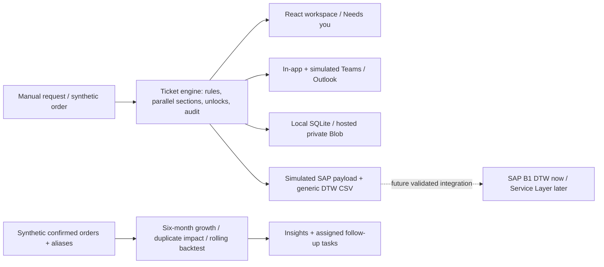

# Lives Group — Create now. Unlock as you go.

A working synthetic prototype for parallel master-data work. Every order or manual request gets a ticket; teams add their own sections while capabilities unlock as requirements are met. A provisional record supports the early workflow, then MDM creates the official record after required expert work is complete.

The earlier MasterGraph prototype used sequential approval routes. The current workspace replaces that primary experience with Tickets, Needs you, New request, Insights, Approval rules and a retained relationship graph. Its glass interface is React 19, TypeScript and custom CSS; the server is Express 5. It does not use Tailwind or Python. Keeping the working application avoids replacing its tested storage and hosting architecture merely to change implementation language.

All customers, orders, FX rates, notifications and analytical outcomes are synthetic. No achieved savings or real forecast accuracy is claimed. Teams and Outlook delivery are simulated; no messages leave the application.

## Run locally

Use Node.js 24 or later.

```bash
npm install
npm run dev
```

Open http://127.0.0.1:5173. The API runs on port 3001, with Vite proxying `/api`. `npm run build` type-checks and builds `dist/`; `npm start` serves the API and built UI. `npm test` runs the repository's Node test suites. These are commands, not a claim that checks have passed in your environment.

## Current workflow

The persona selector offers nine people: Amy (Product Manager), Marcus and Somchai (Sales), Kenji (Procurement), Wei Jie (Finance), Dr Nurul (QA/RA), Daniel (BU Head), Priya (MDM) and Management. It sends a demo `X-User-Id` header; it is not authentication.

- T-1042 / PO-5521 starts with Bangkok Central Lab, QTS, Thailand and USD 48,000 of illustrative order value. Quote is available while Finance credit terms and QA/RA Thailand licence work independently.
- Record types display Customer, Item, Vendor and Cost center; the API enums are `Customer`, `Product`, `Vendor` and `Profit Centre`. Vendor procurement unlocks raising a purchase order; item cost review unlocks selling at list price; cost center Finance review unlocks posting transactions, with BU review separately required.
- Completing a section unlocks its capability. Required expert sections gate MDM's final check and official code; they do not form one sequential approval queue.
- Needs you supports owner actions and batch work. Returned sections go to the requestor for corrections; a decline closes the ticket. Audit entries record workflow changes.
- Customer duplicate checks return up to three official customer candidates at similarity 85% or above. Reuse an existing record, or record a reason for creating a new one. This is heuristic evidence, not a probability or automatic merge.
- Finance and Management can see sensitive credit/bank fields. Other roles receive filtered fields and scrubbed audit values. The role header remains freely selectable, so this demonstrates policy rather than real identity security.
- Rules define ownership, requirements, unlocks and automatic policies for new tickets. Existing tickets retain their original sections. The business-unit wizard and its current limitations are described in the [gap analysis](docs/v2-gap-analysis.md).

The seed credit policy requires **both** an SGD-equivalent limit at most 50,000 and terms at most 30 days. Synthetic FX is SGD 1, THB 0.038, USD 1.35, MYR 0.29, IDR 0.000084 and VND 0.000053. THB 500,000 is about SGD 19,000 but **60 days fails** the automatic policy. Currencies outside that synthetic table require expert review. Licensing is never automatically approved for regulated coverage. A deterministic approximately 10% sample flags auto-cleared tickets for review; it is not a measured audit effectiveness result.

## Notifications and analytics

In-app notifications, bell groups, toast, settings, task digest, and Teams/Outlook previews demonstrate delivery. Quiet hours, delegates, digest state and 24/48/72-hour reminders/escalations are persisted simulation rules. SLA processing runs when notification endpoints are requested; browser polling can trigger it. There is no background scheduler or real Microsoft delivery.

Insights uses a separate reproducible fixture: **150 canonical customers plus 13 aliases**, five countries, three products and twelve months of orders. Confirmed orders alone count as demand. Growth compares the latest six months against the preceding six. Duplicate consolidation is an analytical preview, not a database merge. Recommendation tasks can be assigned and completed.

Forecasting compares a rolling six-month average with an exponential level/trend model on six rolling holdouts. The lower **MAE** selects the winner. MAPE is also reported, excluding zero-actual months; MAE includes them. The empirical range is illustrative, with uncertain coverage. No seasonal model is established from one year.

## Architecture



`server/ticket-engine.js` owns workflow logic; `server/ticket-routes.js` exposes ticket, rule, notification and analytics routes. `server/ticket-seed.js` holds workflow fixtures. `server/ticket-analytics*.js` hold analytical methods and data. `src/tickets/` contains the current workspace; the older graph and API remain for compatibility.

Locally, data is stored in `data/mastergraph.sqlite` (override with `DB_PATH`). Hosted storage uses a dedicated private Vercel Blob snapshot with conditional writes; conflicts require refresh/retry. Demo reset restores workflow fixtures while retaining audit history. Historical analytics fixtures are separate from live workflow tickets.

## Integration and delivery boundaries

Official tickets can export a simulated SAP resource payload. The generic CSV export is a demonstration starting point for DTW mapping, not a validated SAP import template. Neither endpoint writes to SAP. Production requires field mapping, sandbox import tests, idempotency, reconciliation and secure credentials.

Repository: [tancysam/dsa-comp-maybe](https://github.com/tancysam/dsa-comp-maybe). The restored ticket workspace originates from [harshitha904/dsa-comp-maybe](https://github.com/harshitha904/dsa-comp-maybe); see [integration provenance](docs/ui-integration.md). The existing Vercel project remains `dsa-comp-maybe`; deployment status belongs in [deployment notes](docs/deployment.md). Updating source or running a build does not establish that the hosted application has been updated.

See the [nine-step demo](docs/demo-script.md), [brief-to-code gap analysis](docs/v2-gap-analysis.md), and [production plan](docs/production-plan.md). No full Figma frame set was created: implemented browser states are the current design deliverable. Earlier executive-summary/PDF artifacts describe the historical vision and should not be treated as current implementation evidence.

## Preserved repository work
The newer repository commits are retained in Git history and in the separately styled `/legacy.html` workspace, linked from the sidebar. It contains the existing email triage, regional view, graph, rules, impact and light/dark theme. The new order-ticket experience is the default at `/`. Their original API/config routes and tests remain supported.
