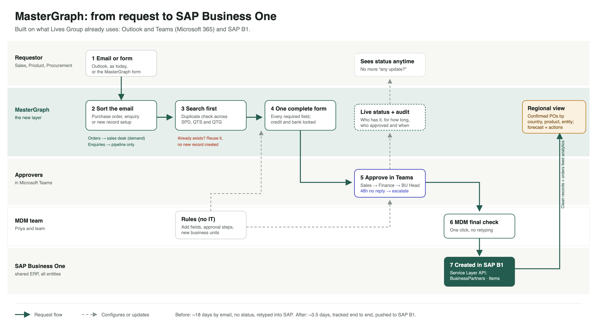

# MasterGraph: Executive Summary

Two-page summary for the 2-minute pitch. All prototype data is synthetic; every figure below comes from the prototype and is labelled where it rests on an assumption.

**Live prototype:** https://dsa-comp-maybe-two.vercel.app · **Code:** https://github.com/harshitha904/dsa-comp-maybe (branch `ui-redesign`) · **Demo video:** _add YouTube link_

---

## Page 1 of 2: The problem and our solution

### The problem
Master data at Lives Group runs on email. A new customer, vendor, item or cost center starts as free text, bounces back for missing fields, and waits in each approver's inbox until they notice it. Amy's item request in the brief took **18 days**. Nobody can see where a request is, there's no reliable audit trail, and bank and credit details travel by plain email.

Because SPD, QTS and QTG each key records into the same SAP B1, the **same hospital ends up under two entities**. That splits its purchase history, so the regional view of demand for Products A, B and C is wrong before anyone starts forecasting, and the forecast itself is a simple moving average.

**Our focus:** fix master data at the point of entry, because clean records are what make faster approvals and trustworthy regional insight possible.

### MasterGraph: one flow from request to SAP B1 to regional insight

| Step | What happens | Pain point it removes |
|---|---|---|
| **Request** | Pasted emails are sorted into *purchase order*, *enquiry* or *setup request*, with the reasons shown. Only setup requests reach the form. The requester searches first and sees existing matches (e.g. "NUH Singapore, 100%") before creating anything. | Duplicates, incomplete forms, orders mixed with MDM requests |
| **Form** | One form per record type with every required field, the approval route shown up front, and Finance-only fields locked. | Missing fields, sensitive data in email |
| **Approve** | Each approver gets a **Teams card** and approves from there. No reply in 48h → automatic reminder and escalation. Everyone sees a live progress bar and full history. | Waiting in inboxes, no status, no audit trail |
| **Rules** | The MDM team adds a field, an approval step or a new business unit themselves. In-flight requests keep their route. | Going back to IT for every change |
| **SAP B1** | After the MDM final check, the record goes to SAP B1 in the Service Layer format (simulated in the prototype). | Manual retyping |

### Why this over the alternatives
- **Email + Excel template:** free, but it's today's 18-day process.
- **SharePoint list + Power Automate:** cheap, but only exact-match duplicate checks and no regional view.
- **Enterprise MDM suite (e.g. SAP MDG):** powerful, but built for S/4HANA scale and overkill for SAP B1.
- **MasterGraph:** sits on what Lives Group already uses (Microsoft 365, Teams, SAP B1) and fixes intake, approvals and analytics together.

---

## Page 2 of 2: Regional view, impact and business case

### Regional business view (Oct 2025 – Sep 2026, 12 months)
- **Measure:** confirmed purchase orders in units, for Products A, B, C across Singapore, Malaysia, Thailand, Indonesia and Vietnam, also split by entity. **13 enquiries and setup requests are kept out of demand.**
- **Growth** = confirmed units in the last 3 months vs the 3 months before. Region: 25,860 units, **−5.2%**. Vietnam **+17.8%**, Malaysia **−50.5%**.
- **Better forecasting:** instead of one moving average, three methods (average, linear trend, Holt's smoothing) are each tested on the last 6 months, **per country**. A newer method is used only if it beats the average. Holt's smoothing wins for the region (2.6% error vs 3.0% for the average); Singapore keeps the average because nothing beat it.
- **Early warning:** customers still ordering but down 15%+ are flagged before they stop (Selangor Healthcare, −19.6%).

**Recommended actions:** (1) contact the Malaysian customer who stopped ordering and review Product A accounts there; (2) reduce reliance on Siam Hospital Group (73% of Thailand); (3) cross-sell Product B to customers who only buy Product A; (4) link the NUH records under SPD and QTS, whose 1,979 units are currently split.

### Expected impact (assumptions, adjustable in the app)
- **18 → ~3.5 days** per request (at most 6.5 with 48h escalation), assuming each approver acts within a day.
- **~64 staff hours a month** saved on chasing, keying and duplicate clean-up, and **~36 duplicate records avoided a year** (assumes 60 requests a month and a 5% duplicate rate).

### Business case
- **Effort:** the MDM team configures fields, steps and escalation themselves. A lean team of 2 people for 6 weeks adds Microsoft 365 sign-in, Teams cards (Power Automate) and the SAP B1 Service Layer link, plus a few SAP partner days.
- **Cost:** about **S$45k one-off** (assumption); running cost is hosting only. At S$45 per staff hour that saves **~S$35k a year → payback in ~16 months**, before counting cleaner forecasts.
- **Adoption:** approvers never leave Teams; the MDM mailbox auto-replies with the form link and pasted emails are pre-filled; requesters see status themselves, so the "any update?" emails stop.
- **Pilot:** 6 weeks, one country and one entity, measuring cycle time, duplicates caught and the share of requests through MasterGraph.

### Not in version 1, and why
Live SAP connection (needs sandbox access), real sign-in (role switcher is for the demo), seasonal forecasting (needs more than 12 months of history), automatic merging of duplicates (a person should confirm).

**Assumptions:** all data is synthetic; the duplicate, the Malaysian drop-off, Vietnam's growth and the Thailand concentration were planted to reflect the brief. Cost and time figures are estimates for Lives Group to replace with their own.
